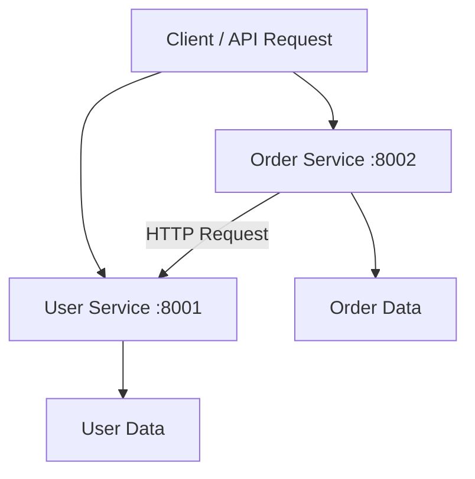

# Microservices GitOps Project

A hands-on DevOps learning project demonstrating a Python-based microservices architecture using FastAPI.

The project contains two independent services: **User Service** and **Order Service**. The Order Service communicates with the User Service to retrieve customer information.

## 1. Architecture



## 2. Technology Stack

| Technology | Purpose |
|---|---|
| Python | Application development |
| FastAPI | REST API framework |
| Uvicorn | ASGI application server |
| HTTPX | Service-to-service communication |
| Pydantic | Data validation |
| Git & GitHub | Version control |

## 3. Project Structure

```text
microservices-gitops/
├── services/
│   ├── user-service/
│   │   └── main.py
│   └── order-service/
│       └── main.py
├── docs/
│   └── daily-progress/
│       └── day-02.md
├── requirements.txt
├── .gitignore
└── README.md
```

## 4. Run Locally

Clone the repository:

```bash
git clone https://github.com/Kanishkcanny/microservices-gitops.git
cd microservices-gitops
```

Create and activate a virtual environment:

```bash
python3 -m venv .venv
source .venv/bin/activate
```

Install dependencies:

```bash
pip install -r requirements.txt
```

### Start User Service

```bash
uvicorn services.user-service.main:app --host 0.0.0.0 --port 8001
```

### Start Order Service

Open a second terminal, activate the same virtual environment, and run:

```bash
uvicorn services.order-service.main:app --host 0.0.0.0 --port 8002
```

## 5. API Endpoints

**User Service — Port 8001**

| Method | Endpoint | Purpose |
|---|---|---|
| GET | `/health` | Health check |
| GET | `/users` | List users |
| GET | `/docs` | Interactive API documentation |

**Order Service — Port 8002**

| Method | Endpoint | Purpose |
|---|---|---|
| GET | `/health` | Health check |
| GET | `/orders` | List orders |
| GET | `/orders/{order_id}` | Get an order |
| GET | `/orders/{order_id}/details` | Get order with associated user |
| GET | `/docs` | Interactive API documentation |

## 6. Test the Services

```bash
curl http://localhost:8001/health
curl http://localhost:8001/users
curl http://localhost:8002/health
curl http://localhost:8002/orders
curl http://localhost:8002/orders/101/details
```

The order details endpoint retrieves the associated user from the User Service.

## 7. Current Implementation Status

- [x] User Service
- [x] Order Service
- [x] REST API endpoints
- [x] Health check endpoints
- [x] HTTP service-to-service communication
- [x] Local API testing
- [x] Git version control
- [x] GitHub repository

## 8. Roadmap

- [ ] Dockerfiles for both services
- [ ] Docker Compose
- [ ] Kubernetes deployments and services
- [ ] Helm charts
- [ ] GitHub Actions CI/CD
- [ ] Argo CD GitOps deployment
- [ ] Prometheus and Grafana monitoring
- [ ] Cloud deployment

## 9. Learning Objectives

This project is intended to demonstrate practical understanding of:

- Microservices architecture
- REST API development
- Service-to-service communication
- Containerization
- Kubernetes orchestration
- CI/CD automation
- GitOps workflows
- Monitoring and troubleshooting

## Repository

[GitHub — microservices-gitops](https://github.com/Kanishkcanny/microservices-gitops)

---

**Project Status:** Initial microservices prototype implemented. DevOps automation and deployment stages are planned.

**Author:** Kanishka Bhardwaj
