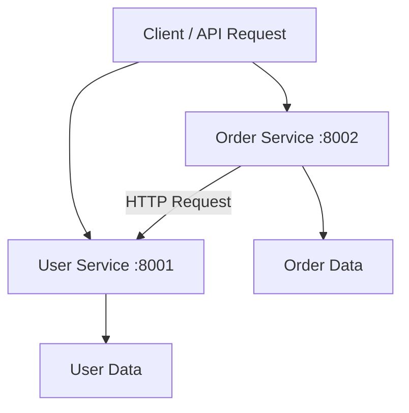
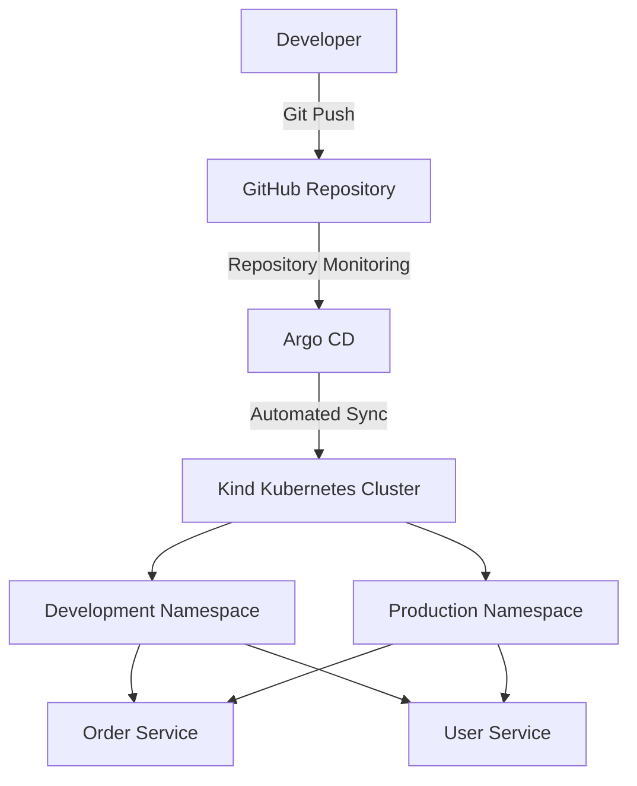

# Microservices GitOps Project

A hands-on DevOps project demonstrating a Python-based microservices architecture deployed on Kubernetes using Docker, Kustomize, Kind and Argo CD.

The project contains two independent FastAPI services that communicate over HTTP. It progressively implements containerization, Kubernetes orchestration, environment-specific configuration and GitOps-based deployment.

**Project:** Microservices GitOps
**Author:** Kanishka Bhardwaj
**Repository:** [github.com/Kanishkcanny/microservices-gitops](https://github.com/Kanishkcanny/microservices-gitops)
**Deployment environment:** Local Kubernetes cluster using Kind

---

## 1. Project Overview

This project demonstrates how to build, containerize, deploy and manage a microservices application using modern DevOps practices.

It contains two services:

- **User Service:** Manages user information and exposes REST API endpoints.
- **Order Service:** Manages order information and communicates with the User Service to retrieve associated user details.

The application is deployed to Kubernetes with separate Development and Production environments.

Argo CD continuously monitors the Git repository and synchronizes Kubernetes resources with the desired configuration.

## 2. Architecture

### Application architecture



### GitOps deployment architecture



### GitOps workflow

1. Kubernetes configuration is maintained in GitHub.
2. Kustomize manages the shared base configuration.
3. Development and Production overlays define environment-specific settings.
4. Argo CD monitors the repository.
5. Argo CD automatically synchronizes Kubernetes resources.
6. Self-healing restores resources when manual changes create configuration drift.

## 3. Technology Stack

| Technology | Purpose |
|---|---|
| Python | Application development |
| FastAPI | REST API framework |
| Uvicorn | ASGI application server |
| HTTPX | Service-to-service communication |
| Pydantic | Data validation |
| Docker | Application containerization |
| Docker Compose | Local multi-container orchestration |
| Kubernetes | Container orchestration |
| Kind | Local Kubernetes cluster |
| Kustomize | Kubernetes configuration management |
| Argo CD | GitOps continuous delivery |
| Git | Version control |
| GitHub | Source code and configuration repository |
| Linux / Ubuntu | Development environment |

## 4. Project Structure

```text
microservices-gitops/
│
├── services/
│   ├── user-service/
│   │   ├── main.py
│   │   └── Dockerfile
│   │
│   └── order-service/
│       ├── main.py
│       └── Dockerfile
│
├── docker/
│
├── kubernetes/
│   ├── base/
│   │   ├── kustomization.yaml
│   │   ├── namespace.yaml
│   │   ├── user-service.yaml
│   │   └── order-service.yaml
│   │
│   └── overlays/
│       ├── dev/
│       │   └── kustomization.yaml
│       │
│       └── prod/
│           └── kustomization.yaml
│
├── gitops/
│   └── argocd/
│       ├── microservices-dev.yaml
│       └── microservices-prod.yaml
│
├── tests/
│
├── docs/
│   ├── daily-progress/
│   ├── troubleshooting/
│   ├── architecture/
│   └── screenshots/
│
├── .github/
│
├── docker-compose.yml
├── requirements.txt
├── .gitignore
└── README.md
```

## 5. Application Services

### User Service

**Port:** 8001

| Method | Endpoint | Purpose |
|---|---|---|
| GET | `/health` | Health check |
| GET | `/users` | List users |
| GET | `/docs` | Interactive API documentation |

### Order Service

**Port:** 8002

| Method | Endpoint | Purpose |
|---|---|---|
| GET | `/health` | Health check |
| GET | `/orders` | List orders |
| GET | `/orders/{order_id}` | Retrieve an order |
| GET | `/orders/{order_id}/details` | Retrieve an order with associated user details |
| GET | `/docs` | Interactive API documentation |

The Order Service communicates with the User Service over HTTP.

## 6. Run the Application with Docker Compose

### Prerequisites

- Ubuntu / Linux
- Docker
- Docker Compose
- Git

Clone the repository:

```bash
git clone https://github.com/Kanishkcanny/microservices-gitops.git

cd microservices-gitops
```

Build and start the services:

```bash
docker compose up -d --build
```

Check containers:

```bash
docker compose ps
```

View logs:

```bash
docker compose logs -f
```

Stop the application:

```bash
docker compose down
```

## 7. Test Application Endpoints

Test the User Service:

```bash
curl http://localhost:8001/health

curl http://localhost:8001/users
```

Test the Order Service:

```bash
curl http://localhost:8002/health

curl http://localhost:8002/orders

curl http://localhost:8002/orders/101/details
```

Expected User Service health response:

```json
{
  "status": "healthy",
  "service": "user-service"
}
```

Expected Order Service health response:

```json
{
  "status": "healthy",
  "service": "order-service"
}
```

The order details endpoint should return order information together with its associated user information.

## 8. Kubernetes Deployment

The application is deployed to a local Kind Kubernetes cluster.

The Kubernetes configuration uses:

- Deployments for both services.
- ClusterIP Services for internal communication.
- Readiness probes.
- Liveness probes.
- CPU and memory requests and limits.
- Kustomize for reusable configuration.

### Verify the cluster

```bash
kubectl get nodes
```

### Verify Development resources

```bash
kubectl get all -n microservices
```

### Verify Production resources

```bash
kubectl get all -n microservices-prod
```

### Check deployments

```bash
kubectl get deployments -n microservices

kubectl get deployments -n microservices-prod
```

### Check pods

```bash
kubectl get pods -o wide -n microservices

kubectl get pods -o wide -n microservices-prod
```

## 9. Kustomize Environment Configuration

Kustomize is used to maintain a common Kubernetes base configuration and environment-specific overlays.

### Base configuration

The base contains shared Kubernetes resources:

- Namespace
- User Service
- Order Service
- Deployments
- Services

### Development environment

Path:

```text
kubernetes/overlays/dev/
```

Apply Development configuration:

```bash
kubectl apply -k kubernetes/overlays/dev
```

### Production environment

Path:

```text
kubernetes/overlays/prod/
```

Apply Production configuration:

```bash
kubectl apply -k kubernetes/overlays/prod
```

### Validate rendered manifests

Development:

```bash
kubectl kustomize kubernetes/overlays/dev
```

Production:

```bash
kubectl kustomize kubernetes/overlays/prod
```

### Environment configuration

| Configuration | Development | Production |
|---|---|---|
| Namespace | microservices | microservices-prod |
| Order Service replicas | 2 | 1 |
| User Service replicas | 2 | 1 |
| Configuration | Dev overlay | Prod overlay |

## 10. Argo CD GitOps Deployment

Argo CD is used to implement GitOps continuous delivery.

Two Argo CD Applications are configured:

- `microservices-dev`
- `microservices-prod`

Both applications use the GitHub repository as their source of truth.

### Argo CD configuration

Repository:

```text
https://github.com/Kanishkcanny/microservices-gitops.git
```

Development path:

```text
kubernetes/overlays/dev
```

Production path:

```text
kubernetes/overlays/prod
```

### Verify Argo CD applications

```bash
kubectl get applications -n argocd
```

Expected status:

```text
NAME                SYNC STATUS   HEALTH STATUS
microservices-dev   Synced        Healthy
microservices-prod  Synced        Healthy
```

### Inspect an application

```bash
kubectl describe application microservices-dev -n argocd
```

```bash
kubectl describe application microservices-prod -n argocd
```

### Important GitOps settings

The applications use automated synchronization with:

- Automated sync
- Prune enabled
- Self-heal enabled
- Namespace creation enabled

This allows Argo CD to reconcile the cluster with the desired configuration stored in Git.

## 11. Service-to-Service Communication Testing

The Order Service communicates with the User Service using Kubernetes service discovery.

Test communication from the Order Service pod in Development:

```bash
kubectl exec -n microservices deployment/order-service -- \
python -c "import urllib.request; print(urllib.request.urlopen('http://user-service:8001/health').read().decode())"
```

Test communication in Production:

```bash
kubectl exec -n microservices-prod deployment/order-service -- \
python -c "import urllib.request; print(urllib.request.urlopen('http://user-service:8001/health').read().decode())"
```

Expected response:

```json
{"status":"healthy","service":"user-service"}
```

## 12. Argo CD Self-Healing Verification

Self-healing was tested in the Production environment.

### Test scenario

1. Checked the Production Order Service replica count.
2. Manually scaled the deployment from one replica to zero.
3. Argo CD detected the configuration drift.
4. Argo CD restored the replica count to the desired value of one.
5. Verified the deployment returned to a healthy state.

### Test commands

```bash
kubectl get deployment order-service -n microservices-prod
```

Manually scale the deployment:

```bash
kubectl scale deployment order-service \
--replicas=0 -n microservices-prod
```

Check the deployment:

```bash
kubectl get deployment order-service -n microservices-prod
```

Verify Argo CD:

```bash
kubectl get applications -n argocd
```

Verify the final replica count:

```bash
kubectl get deployment order-service -n microservices-prod
```

**Verified outcome:** Argo CD restored the manually changed replica count to one and the application returned to `Synced / Healthy`.

## 13. Testing and Validation

The following scenarios have been verified in the local Kind cluster:

| Test | Result |
|---|---|
| Development deployment | Verified |
| Production deployment | Verified |
| Development Argo CD sync | Verified |
| Production Argo CD sync | Verified |
| Kubernetes pod readiness | Verified |
| Service-to-service communication | Verified |
| Application health endpoints | Verified |
| Automated synchronization | Verified |
| Argo CD self-healing | Verified |
| Production replica restoration | Verified |

These results refer to the local Kind environment, not a cloud-hosted production environment.

## 14. Troubleshooting and Documentation

Project implementation notes and troubleshooting reports are maintained in:

```text
docs/
├── daily-progress/
├── troubleshooting/
├── architecture/
└── screenshots/
```

Topics documented include:

- Docker and WSL networking.
- Kubernetes deployment configuration.
- Kustomize overlays.
- Namespace configuration.
- Argo CD synchronization.
- Production deployment validation.
- Self-healing verification.

## 15. Current Implementation Status

### Completed

- [x] User Service
- [x] Order Service
- [x] REST API endpoints
- [x] Health-check endpoints
- [x] HTTP service-to-service communication
- [x] Dockerfiles
- [x] Docker Compose configuration
- [x] Kubernetes Deployments and Services
- [x] Readiness and liveness probes
- [x] Kustomize base configuration
- [x] Development overlay
- [x] Production overlay
- [x] Kind local Kubernetes cluster
- [x] Argo CD installation and configuration
- [x] GitHub repository integration
- [x] Automated synchronization
- [x] Automated pruning and self-healing
- [x] Development and Production deployment validation
- [x] Production self-healing test
- [x] Technical documentation

### Planned

- [ ] Helm chart implementation
- [ ] GitHub Actions CI/CD pipeline
- [ ] Automated application test pipeline
- [ ] Prometheus monitoring
- [ ] Grafana dashboards
- [ ] Cloud deployment
- [ ] Production-grade security and secrets management

## 16. Future Roadmap

The next development stages will focus on:

1. Implementing automated application tests.
2. Creating a GitHub Actions CI pipeline.
3. Packaging Kubernetes deployments with Helm.
4. Integrating Prometheus and Grafana.
5. Implementing observability and alerting.
6. Deploying the application to AWS.
7. Improving security and secrets management.

## 17. Learning Objectives

This project provides practical experience with:

- Microservices architecture.
- REST API development using FastAPI.
- Docker containerization.
- Docker Compose networking.
- Kubernetes orchestration.
- Kubernetes Deployments and Services.
- Kustomize configuration management.
- Kind local Kubernetes clusters.
- Argo CD GitOps workflows.
- Automated synchronization and self-healing.
- Service discovery and internal networking.
- Deployment troubleshooting.
- Infrastructure and application documentation.

---

## Project Status

**Local Kubernetes GitOps implementation completed and verified using Kind and Argo CD.**

The application has separate Development and Production configurations, automated synchronization and a verified self-healing workflow.

Cloud deployment, monitoring and additional CI/CD automation remain planned.

## Author

**Kanishka Bhardwaj**

DevOps Engineer | AWS | Kubernetes | Terraform | Docker | CI/CD

- GitHub: [Kanishkcanny](https://github.com/Kanishkcanny)
- LinkedIn: [Kanishka Bhardwaj](https://www.linkedin.com/in/kanishka-bhardwaj-a88a09193/)
