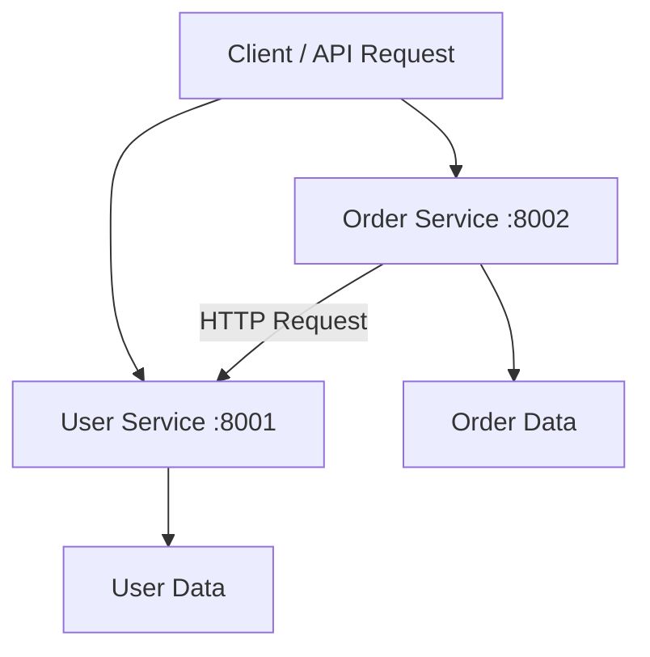

# Microservices GitOps Project

A hands-on DevOps learning project demonstrating a Python-based microservices architecture using FastAPI, Docker and Docker Compose.

The project contains two independent services:

- **User Service** – manages user information.
- **Order Service** – manages order information and communicates with the User Service.

The goal is to progressively implement containerization, Kubernetes orchestration, CI/CD automation and GitOps deployment.

## 1. Architecture



### Service communication

The Order Service calls the User Service to retrieve the user associated with an order.

## 2. Technology Stack

| Technology | Purpose |
|---|---|
| Python | Application development |
| FastAPI | REST API framework |
| Uvicorn | ASGI application server |
| HTTPX | Service-to-service communication |
| Pydantic | Data validation |
| Docker | Containerization |
| Docker Compose | Multi-container orchestration |
| Git & GitHub | Version control |

## 3. Project Structure

```text
microservices-gitops/
├── services/
│   ├── user-service/
│   │   ├── main.py
│   │   └── Dockerfile
│   └── order-service/
│       ├── main.py
│       └── Dockerfile
├── docker/
├── kubernetes/
├── helm/
├── gitops/
├── tests/
├── docs/
│   ├── daily-progress/
│   └── troubleshooting/
├── .github/
├── docker-compose.yml
├── requirements.txt
├── .gitignore
└── README.md
```

## 4. Run with Docker Compose

### Prerequisites

- Docker Desktop
- Docker Compose
- Git

### Clone the repository

```bash
git clone https://github.com/Kanishkcanny/microservices-gitops.git
cd microservices-gitops
```

### Build and start services

```bash
docker compose up -d --build
```

### Check running containers

```bash
docker compose ps
```

### View service logs

```bash
docker compose logs -f
```

### Stop services

```bash
docker compose down
```

## 5. API Endpoints

### User Service – Port 8001

| Method | Endpoint | Purpose |
|---|---|---|
| GET | `/health` | Health check |
| GET | `/users` | List users |
| GET | `/docs` | Interactive API documentation |

### Order Service – Port 8002

| Method | Endpoint | Purpose |
|---|---|---|
| GET | `/health` | Health check |
| GET | `/orders` | List orders |
| GET | `/orders/{order_id}` | Get an order |
| GET | `/orders/{order_id}/details` | Get order with associated user |
| GET | `/docs` | Interactive API documentation |

## 6. Test the Services

After starting Docker Compose, test the endpoints:

```bash
curl http://localhost:8001/health
curl http://localhost:8001/users
curl http://localhost:8002/health
curl http://localhost:8002/orders
curl http://localhost:8002/orders/101/details
```

Expected health-check responses:

```json
{"status":"healthy","service":"user-service"}
```

```json
{"status":"healthy","service":"order-service"}
```

The order details endpoint should return order information together with the associated user information.

**Note:** If localhost port forwarding does not work from your WSL environment, test the published ports from Windows PowerShell or follow the documented networking troubleshooting procedure.

## 7. Run Locally Without Docker

Create a virtual environment:

```bash
python3 -m venv .venv
source .venv/bin/activate
```

Install dependencies:

```bash
pip install -r requirements.txt
```

Start the User Service in Terminal 1:

```bash
uvicorn services.user-service.main:app --host 0.0.0.0 --port 8001
```

Start the Order Service in Terminal 2:

```bash
uvicorn services.order-service.main:app --host 0.0.0.0 --port 8002
```

## 8. Troubleshooting

Troubleshooting reports and investigation notes are maintained in the `docs/troubleshooting/` directory.

Topics include:

- WSL and Docker Desktop networking.
- Container-to-container communication.
- Host-to-container connectivity.
- API endpoint validation.

## 9. Current Implementation Status

- [x] User Service
- [x] Order Service
- [x] REST API endpoints
- [x] Health-check endpoints
- [x] HTTP service-to-service communication
- [x] Local API testing
- [x] Dockerfiles for both services
- [x] Docker Compose configuration
- [x] Container networking validation
- [ ] Automated application tests
- [ ] Kubernetes deployments and services
- [ ] Helm charts
- [ ] GitHub Actions CI/CD
- [ ] Argo CD GitOps deployment
- [ ] Prometheus and Grafana monitoring
- [ ] Cloud deployment

## 10. Roadmap

The project will be developed incrementally:

1. Build and validate microservices.
2. Containerize both services.
3. Automate builds and tests with GitHub Actions.
4. Deploy services to Kubernetes.
5. Package deployments with Helm.
6. Implement GitOps using Argo CD.
7. Add monitoring with Prometheus and Grafana.
8. Explore cloud deployment.

## 11. Learning Objectives

This project is intended to demonstrate practical understanding of:

- Microservices architecture
- REST API development
- Service-to-service communication
- Docker and containerization
- Docker Compose networking
- Kubernetes orchestration
- CI/CD automation
- GitOps workflows
- Monitoring and troubleshooting

## Repository

[GitHub – microservices-gitops](https://github.com/Kanishkcanny/microservices-gitops)

**Project Status:** Microservices prototype with Docker Compose implemented. Kubernetes, CI/CD and GitOps stages are planned.

**Author:** Kanishka Bhardwaj
